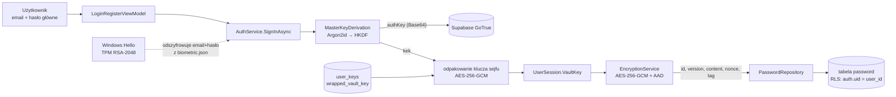
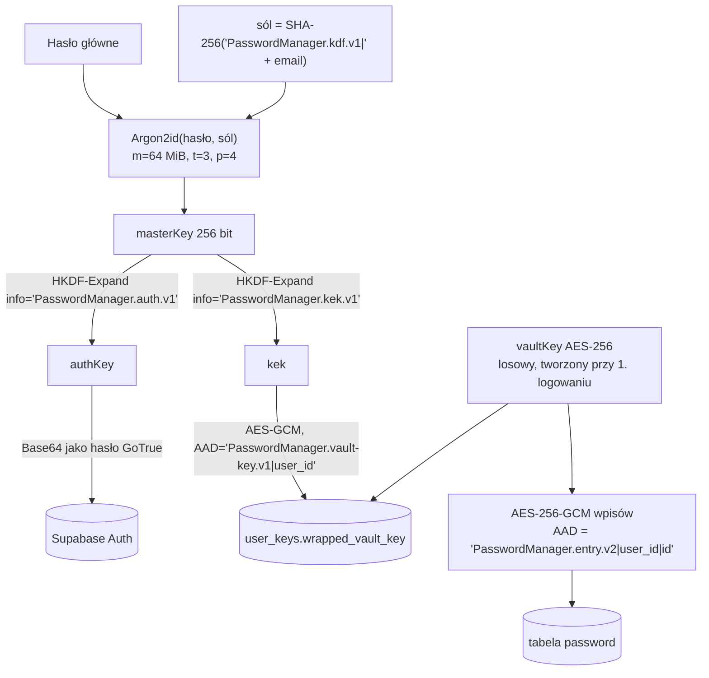

# PasswordManager: analiza bezpieczeństwa i kryptografii

> Stan na: 2026-11-24, gałąź `security-v2`, po wdrożeniu modelu kluczy v2.
> Struktura bazy na podstawie `supabase/schema.sql` (`supabase db dump --linked`).
> Zakres: stos technologiczny, algorytmy, problemy znalezione w pierwotnej wersji i sposób ich
> rozwiązania, otwarte kwestie oraz możliwe zastosowania Diffie-Hellmana (ECDH).
>
> Szczegółowy opis wyprowadzania kluczy (krok po kroku, nazwy i stałe): [kdf.md](kdf.md).

## Spis treści
1. [Stos technologiczny](#1-stos-technologiczny)
2. [Przepływ danych i kluczy](#2-przepływ-danych-i-kluczy)
3. [Algorytmy: ocena](#3-algorytmy-ocena)
4. [Znalezione problemy i ich status](#4-znalezione-problemy-i-ich-status)
5. [Wdrożony model kluczy (v2)](#5-wdrożony-model-kluczy-v2)
6. [Diffie-Hellman (ECDH): gdzie i jak](#6-diffie-hellman-ecdh-gdzie-i-jak)
7. [Status wdrożenia i dalsze kroki](#7-status-wdrożenia-i-dalsze-kroki)
8. [Ograniczenia modelu](#8-ograniczenia-modelu)

---

## 1. Stos technologiczny

| Warstwa         | Technologia                                                                                                                        | Uwagi                                                                          |
|-----------------|------------------------------------------------------------------------------------------------------------------------------------|--------------------------------------------------------------------------------|
| Runtime         | .NET 10 (`net10.0`, `net10.0-windows10.0.19041.0`)                                                                                 | Drugi target tylko dla funkcji Windows (Hello, blokada sesji)                  |
| UI              | Avalonia 12.1 + Fluent, `MessageBox.Avalonia`                                                                                      | Aplikacja desktopowa, wieloplatformowa                                         |
| MVVM / DI       | CommunityToolkit.Mvvm 8.4, Microsoft.Extensions.DependencyInjection/Hosting                                                        | Serwisy rejestrowane w `Config/ServiceExtensions.cs`                           |
| Backend         | Supabase 8.3: **GoTrue** (auth), **Postgrest** (tabele `password`, `user_keys`), Realtime                                          | Klucz `PublishableKey` w `appsettings.json` (publiczny z założenia)            |
| Baza danych     | PostgreSQL (Supabase) z RLS                                                                                                        | Schemat w `supabase/schema.sql`, zmiany jako migracje w `supabase/migrations/` |
| Kryptografia    | `System.Security.Cryptography` (`AesGcm`, `HKDF`, `SHA256`, `RandomNumberGenerator`), `Konscious.Security.Cryptography.Argon2` 1.3 | Pomocnicze klasy w `Service/Crypto/`                                           |
| Biometria       | Windows Hello: `KeyCredentialManager` (klucz RSA w TPM)                                                                            | `Platform/Windows/WindowsHelloAuthenticator.cs`, tylko Windows                 |
| Blokada sesji   | `Microsoft.Win32.SystemEvents` (`SessionSwitch`)                                                                                   | `Platform/Windows/WindowsSessionLockNotifier.cs`, tylko Windows                |
| Generator haseł | `PasswordGenerator` 3.0                                                                                                            | Używa `RandomNumberGenerator` (CSPRNG)                                         |

Kod specyficzny dla Windows leży w `Platform/Windows/` i nie jest kompilowany dla targetu `net10.0`.
Na innych systemach używane są zamienniki: `UnsupportedBiometricAuthenticator`, `NoSessionLockNotifier`.

---

## 2. Przepływ danych i kluczy



Najważniejsze cechy:
- **Hasło główne nie opuszcza urządzenia.** Supabase dostaje tylko `authKey`, z którego nie da się wyliczyć klucza szyfrującego.
- **Wpisy szyfruje losowy klucz sejfu**, a nie klucz wyliczony z hasła. Z hasła pochodzi tylko `kek`, który ten klucz „opakowuje”.
- **Każdy szyfrogram jest związany z właścicielem i wpisem** przez AAD.

### 2.1 Struktura bazy (`supabase/schema.sql`)

```sql
CREATE TABLE public.password (
    id         uuid NOT NULL,                             -- PK; UUIDv7 generowany przez klienta, część AAD
    created_at timestamptz DEFAULT now() NOT NULL,
    user_id    uuid DEFAULT auth.uid() NOT NULL           -- wypełniane przez bazę, klient go nie wysyła
               REFERENCES auth.users(id) ON DELETE CASCADE,
    updated_at timestamptz DEFAULT now() NOT NULL,        -- trigger moddatetime
    content    text DEFAULT '' NOT NULL,                  -- base64(AES-GCM ciphertext)
    nonce      text DEFAULT '' NOT NULL,                  -- base64(96 bit)
    tag        text DEFAULT '' NOT NULL,                  -- base64(128 bit)
    version    smallint NOT NULL                          -- format szyfrogramu (obecnie 2)
);
CREATE INDEX password_user_id_idx ON public.password (user_id);

CREATE TABLE public.user_keys (
    user_id           uuid DEFAULT auth.uid() NOT NULL PRIMARY KEY
                      REFERENCES auth.users(id) ON DELETE CASCADE,
    kdf_version       smallint NOT NULL,                  -- wersja parametrów KDF (obecnie 1)
    wrapped_vault_key text NOT NULL,                      -- base64(nonce | tag | ciphertext)
    created_at        timestamptz DEFAULT now() NOT NULL,
    updated_at        timestamptz DEFAULT now() NOT NULL  -- trigger moddatetime
);

-- Obie tabele:
ALTER TABLE ... ENABLE ROW LEVEL SECURITY;
CREATE POLICY "owner only" ON ... TO authenticated
    USING ((SELECT auth.uid()) = user_id)
    WITH CHECK ((SELECT auth.uid()) = user_id);
GRANT SELECT, INSERT, UPDATE, DELETE ON ... TO authenticated;   -- anon: brak uprawnień
```

- Polityka obejmuje wszystkie operacje, ale tylko dla zalogowanych (`TO authenticated`).
- `WITH CHECK` uniemożliwia wstawienie albo przepisanie wiersza na cudzy `user_id`.
- Rola `anon` nie ma uprawnień do tabel, więc ochrona nie zależy wyłącznie od RLS.
- Tabele **nie** są w publikacji `supabase_realtime`.
- Na serwerze są tylko szyfrogramy. Nazwa, URL, login i kategoria wpisu też są zaszyfrowane (cały `PasswordEntry` jako JSON). Serwer widzi tylko liczbę wpisów, ich rozmiary i znaczniki czasu.

Zmiany schematu: `supabase/migrations/20261123193846_vault_v2.sql` (hardening, `user_keys`, wersjonowanie)
i `20261123210714_password_uuid_primary_key.sql` (UUID jako jedyny identyfikator wpisu).

---

## 3. Algorytmy: ocena

| Element                      | Algorytm                                                                                                                      | Gdzie                                                      | Ocena                                                           |
|------------------------------|-------------------------------------------------------------------------------------------------------------------------------|------------------------------------------------------------|-----------------------------------------------------------------|
| Wyprowadzanie kluczy z hasła | Argon2id (m = 64 MiB, t = 3, p = 4), sól = SHA-256(prefiks + email) → HKDF-Expand-SHA256 na `authKey` i `kek`                 | `Service/Crypto/MasterKeyDerivation.cs`                    | ✅ Memory-hard KDF, separacja kluczy                            |
| Uwierzytelnianie             | Supabase GoTrue, hasłem konta jest Base64(`authKey`)                                                                          | `Service/AuthService.cs`                                   | ✅ Serwer nie zna hasła głównego                                |
| Klucz sejfu                  | Losowe 32 B (`RandomNumberGenerator`), opakowane AES-256-GCM kluczem `kek`, AAD z `user_id`                                   | `AuthService`, `AesGcmBox`                                 | ✅                                                              |
| Szyfrowanie wpisów           | AES-256-GCM, losowy nonce 96 bit, tag 128 bit, AAD = `entry.v2\|user_id\|id`, pole `version`                                  | `Service/EncryptionService.cs`                             | ✅                                                              |
| Izolacja danych użytkowników | RLS (`USING` + `WITH CHECK`), brak uprawnień dla `anon`, FK `ON DELETE CASCADE`                                               | `supabase/schema.sql`                                      | ✅                                                              |
| Windows Hello                | RSA-2048 w TPM → podpis stałego challenge'a → HKDF-SHA256 (losowa sól) → AES-256-GCM z AAD; atestacja TPM; hash emaila z solą | `WindowsHelloAuthenticator.cs`, `BiometricLoginService.cs` | ✅ Przechowuje hasło główne (świadomy kompromis, sekcja 5.6)    |
| Generator haseł              | CSPRNG                                                                                                                        | `AddEditPasswordViewModel.cs`                              | ✅                                                              |
| Polityka hasła głównego      | ≥ 12 znaków + 4 klasy znaków                                                                                                  | `LoginRegisterViewModel.cs`                                | ✅ Można dodać sprawdzanie haseł z wycieków (HIBP, k-anonymity) |

---

## 4. Znalezione problemy i ich status

Sekcja opisuje problemy znalezione w pierwotnej wersji aplikacji i sposób ich rozwiązania.

### 4.1 ✅ Krytyczny: brak zero-knowledge (rozwiązane)
**Było:** `SignInAsync` wysyłał do Supabase email i **hasło główne**, a klucz sejfu był deterministyczną funkcją tych samych danych. Kto kontrolował serwer, widział hasło przy każdym logowaniu i mógł odszyfrować cały sejf.

**Jest:** do Supabase trafia tylko `authKey = HKDF(Argon2id(hasło), "auth")`. Klucz szyfrujący pochodzi z innej gałęzi HKDF (`kek`), więc znajomość `authKey` nic nie daje. Szczegóły: sekcja 5 i [kdf.md](kdf.md).

### 4.2 ✅ Krytyczny: słabe wyprowadzenie klucza AES-256 (rozwiązane)
**Było:** `HashCredentials` liczył jedno SHA-256 z „przesuniętych” znaków (`ShiftChar`):
- brak kosztu obliczeniowego (miliardy prób na sekundę na GPU);
- kolizje: np. `'~'` i `'!'` na pozycji 0 dawały ten sam klucz, znaki spoza ASCII były zawijane do ASCII.

**Jest:** Argon2id (64 MiB, 3 przebiegi) na każdą próbę hasła. `HashCredentials` i `ShiftChar` zostały usunięte.

### 4.3 ✅ Wysoki: klucz zależał bezpośrednio od hasła (rozwiązane)
**Było:** zmiana hasła lub emaila wymagałaby przeszyfrowania wszystkich wpisów.

**Jest:** wpisy szyfruje losowy klucz sejfu. Zmiana hasła to ponowne opakowanie 32 bajtów w `user_keys` (funkcja zmiany hasła nie jest jeszcze zaimplementowana w aplikacji, sekcja 7).

### 4.4 ✅ Średni: AES-GCM bez AAD (rozwiązane, z jednym wyjątkiem)
**Było:** szyfrogram nie był związany z wierszem ani użytkownikiem. Ktoś omijający RLS (administrator projektu, wyciek klucza `service_role`, backup) mógł zamieniać szyfrogramy między wierszami lub użytkownikami bez wykrycia.

**Jest:** AAD = `PasswordManager.entry.v2|{user_id}|{id}`. Zamiana szyfrogramów kończy się błędem tagu. Takie wpisy są pomijane, a użytkownik dostaje ostrzeżenie z ich liczbą (`PasswordService.GetPasswords`, `MainViewModel.ListPasswords`).

**Nadal możliwe** dla kogoś z dostępem do bazy z pominięciem RLS:
- **przywrócenie starszej wersji tego samego wpisu** (rollback) – stary szyfrogram ma to samo `id` i `user_id`, więc AAD się zgadza;
- **usunięcie wpisów** – klient nie wie, ile wpisów powinno być.

Obrona wymagałaby np. podpisanego lub zaszyfrowanego „manifestu” sejfu z listą `id` i licznikiem wersji. Dla obecnego modelu zagrożeń uznane za akceptowalne.

### 4.5 ✅ RLS i uprawnienia w Supabase (rozwiązane, migracja zastosowana)
Pierwotna polityka `(SELECT auth.uid()) = user_id` poprawnie izolowała dane użytkowników, ale zrzut bazy pokazał kilka słabszych miejsc typu *defense in depth*. Wszystkie poprawia migracja `20261123193846_vault_v2.sql`:

| Stan pierwotny                                                              | Skutek                                                                | Stan obecny                                                           |
|-----------------------------------------------------------------------------|-----------------------------------------------------------------------|-----------------------------------------------------------------------|
| `GRANT ALL ON TABLE password TO anon`                                       | Wyłączenie RLS (np. przez pomyłkę w panelu) od razu odsłaniało tabelę | ✅ `anon` nie ma uprawnień do tabel                                   |
| `GRANT ALL` (także `TRUNCATE`, `REFERENCES`, `TRIGGER`) dla `authenticated` | Zbędne uprawnienia; RLS nie dotyczy `TRUNCATE`                        | ✅ Tylko `SELECT, INSERT, UPDATE, DELETE`                             |
| `ALTER DEFAULT PRIVILEGES … TO anon`                                        | Każda nowa tabela w `public` dostawała pełne uprawnienia dla `anon`   | ✅ Domyślne uprawnienia bez `anon`; `authenticated` dostaje tylko DML |
| Polityka bez `TO authenticated` i bez `WITH CHECK`                          | Działała, ale intencja nie była jawna                                 | ✅ `TO authenticated USING (…) WITH CHECK (…)`                        |
| Brak klucza obcego `user_id → auth.users(id)`                               | Po usunięciu konta wpisy zostawały w bazie (RODO)                     | ✅ `ON DELETE CASCADE` (obie tabele)                                  |
| Brak indeksu na `user_id`                                                   | Skan całej tabeli przy każdym zapytaniu z RLS                         | ✅ `password_user_id_idx`                                             |
| Nazwy `vaults_*`                                                            | Pozostałość po zmianie nazwy tabeli                                   | ✅ `password_*`                                                       |

Uwaga na przyszłość: każda nowa tabela **musi** mieć `ENABLE ROW LEVEL SECURITY` i własną politykę. `authenticated` dostaje do nowych tabel domyślnie DML, więc bez RLS każdy zalogowany widziałby wszystkie wiersze. Przy dodawaniu funkcji RPC trzeba ręcznie odebrać `EXECUTE` roli `PUBLIC` i `anon`.

### 4.6 Średni: higiena sesji
| Problem                                         | Status                                                                                                                                                                                                                                                                     |
|-------------------------------------------------|----------------------------------------------------------------------------------------------------------------------------------------------------------------------------------------------------------------------------------------------------------------------------|
| Klucze w pamięci nie były zerowane              | ✅ `masterKey`, `authKey`, `kek` są zerowane od razu po użyciu, `VaultKey` przy wylogowaniu (`UserSession.Clear`). Bajty tekstu jawnego wpisów są zerowane po (de)szyfrowaniu.                                                                                             |
| Odszyfrowane wpisy i hasło główne jako `string` | ⚠️ Otwarte. `string` w .NET jest niezmienny i nie da się go wyzerować; pozostaje w pamięci do czasu działania GC. Typowe ograniczenie aplikacji .NET.                                                                                                                      |
| Schowek nie był czyszczony                      | ✅ Hasło znika ze schowka po 30 s (jeśli nadal tam jest), przy wylogowaniu i przy zamknięciu aplikacji (`Utils/ClipboardHelper.cs`).                                                                                                                                       |
| Hasło w historii schowka                        | ⚠️ Otwarte. Historia schowka Windows (Win+V), synchronizacja w chmurze i menedżery schowka na Linuksie (Klipper, GNOME) mogą przechować kopię. Na Windows pomogłyby formaty `ExcludeClipboardContentFromMonitorProcessing` / `CanIncludeInClipboardHistory`.               |
| Brak automatycznej blokady                      | ✅ Wylogowanie po 5 min bez aktywności w dowolnym oknie aplikacji oraz od razu po zablokowaniu sesji Windows (`Service/AutoLockService.cs`). Na Linuksie blokada ekranu nie jest wykrywana (możliwe przez D-Bus: `org.freedesktop.login1`, `org.freedesktop.ScreenSaver`). |
| `AutoConnectRealtime = true`                    | ⚠️ Otwarte. Realtime nie jest używany, więc to zbędne połączenie WebSocket. Wystarczy ustawić `false` w `ServiceExtensions.ConfigureSupabase`.                                                                                                                             |

### 4.7 Niski
| Problem                                 | Status                                                                         |
|-----------------------------------------|--------------------------------------------------------------------------------|
| Brak wersji formatu szyfrogramu         | ✅ `password.version` (2) i `user_keys.kdf_version` (1)                        |
| Brak testów jednostkowych kryptografii  | ⚠️ Otwarte (round-trip, wykrywanie manipulacji, wektory testowe Argon2id/HKDF) |
| Certificate pinning dla domeny Supabase | ⚠️ Otwarte (opcjonalne)                                                        |

---

## 5. Wdrożony model kluczy (v2)

Model wzorowany na Bitwardenie i 1Password. Cele:
1. serwer nigdy nie widzi hasła ani niczego, z czego da się szybko wyliczyć klucz (zero-knowledge);
2. łamanie hasła offline jest kosztowne (memory-hard KDF);
3. zmiana hasła nie wymaga ponownego szyfrowania wpisów.



Pełny opis krok po kroku, z nazwami zmiennych i stałymi: [kdf.md](kdf.md). Poniżej najważniejsze decyzje.

### 5.1 KDF: Argon2id
- Biblioteka `Konscious.Security.Cryptography.Argon2`, liczone poza wątkiem UI.
- Parametry m = 64 MiB, t = 3, p = 4 są stałe dla `MasterKeyDerivation.CurrentVersion = 1` i zapisane jako `user_keys.kdf_version`.
- **Sól deterministyczna z emaila** (znormalizowanego: `Trim().ToLowerInvariant()`), bo musi być znana przed zalogowaniem. Losowa sól z serwera wymagałaby publicznego zapytania przed logowaniem i ujawniałaby, czy konto istnieje.

### 5.2 Rozdzielenie klucza logowania i szyfrowania (HKDF)
- `authKey` i `kek` powstają z `masterKey` przez HKDF-Expand z różnym `info`.
- Serwer zna tylko `authKey` (GoTrue przechowuje jego hash bcrypt). Z niego nie da się wyliczyć `kek`.
- Base64 z 32 losowych bajtów nie zawsze spełnia wymagania co do znaków hasła, dlatego **w Supabase muszą być wyłączone wymagania co do znaków hasła**. Siła tego „hasła” to pełne 256 bitów.

### 5.3 Losowy klucz sejfu (key wrapping)
- Tworzony przy **pierwszym logowaniu**, a nie przy rejestracji: przy włączonym potwierdzaniu emaila po rejestracji nie ma jeszcze sesji, więc RLS nie pozwoliłby zapisać `user_keys`.
- Zapisywany jako `AesGcmBox.SealBlob(kek, vaultKey, AAD)` = `nonce | tag | ciphertext` w Base64.
- `user_id` w `user_keys` wypełnia baza (`DEFAULT auth.uid()`), klient go nie wysyła.
- Jeśli logowanie w Supabase się uda, ale klucza nie da się odpakować (np. hasło zresetowano mailem), aplikacja wylogowuje i zgłasza `VaultUnlockException` („Unable to unlock the vault”).
- Kopia opakowanego klucza w `UserSession` pozwala sprawdzić hasło główne bez serwera (`VerifyMasterPasswordAsync`, używane przy włączaniu Windows Hello).

### 5.4 Szyfrowanie wpisów z AAD
- Identyfikator wpisu (`password.id`) to UUIDv7 generowany przez klienta (`Guid.CreateVersion7()`). Musi być znany przed szyfrowaniem, żeby trafić do AAD. Dawny `id` typu `bigint IDENTITY` został usunięty.
- `Decrypt` odrzuca wpisy w innej wersji niż 2 oraz nieprawidłowy Base64.
- Losowy nonce 96-bit jest bezpieczny do ~2³² szyfrowań jednym kluczem, z dużym zapasem.

### 5.5 Migracja danych
Migracji danych v1 → v2 **nie było**: dane testowe i konta zostały usunięte (`TRUNCATE` w migracji `vault_v2`, konta ręcznie w panelu Supabase). Konta utworzone przed zmianą nie zalogują się, bo ich hasło GoTrue to dawne hasło główne, a nie `authKey`.

### 5.6 Windows Hello
- Hello przechowuje email i hasło główne, zaszyfrowane kluczem pochodzącym z TPM, w `biometric.json` (email zastąpiony solonym hashem). Logowanie przez Hello wywołuje zwykłe `SignInAsync`, więc przechodzi tę samą ścieżkę KDF. Zmiana KDF nie wymaga zmian w Hello.
- Nieaktualne dane (zmienione hasło, usunięte konto) wyłączają Hello z komunikatem.
- **Kompromis:** zaszyfrowane hasło główne leży na dysku. Alternatywą byłoby przechowywanie `vaultKey` + refresh tokenu Supabase (hasło nigdy nie trafia na dysk), co wymaga obsługi rotacji refresh tokenów. Pole `Version` w `biometric.json` pozwala na taką zmianę.

---

## 6. Diffie-Hellman (ECDH): gdzie i jak

> Nie wdrożone. Opis możliwego rozszerzenia.

**DH nie zastępuje KDF.** KDF zamienia *hasło* na klucz. Diffie-Hellman pozwala **dwóm stronom** uzgodnić wspólny sekret przez niezaufany kanał (tu: przez serwer Supabase) bez przesyłania sekretu. W tym projekcie ma sens w dwóch scenariuszach.

W .NET: `ECDiffieHellman` z krzywą **P-256** (wbudowane, wieloplatformowe). X25519 nie jest wbudowany w .NET; wymagałby zewnętrznej biblioteki (np. NSec/libsodium).

### 6.1 Para kluczy użytkownika
- Przy pierwszym logowaniu: `ECDiffieHellman.Create(ECCurve.NamedCurves.nistP256)`.
- `public_key` (SubjectPublicKeyInfo, Base64) trafia jawnie do `user_keys` (nowa kolumna).
- Klucz prywatny (PKCS#8) jest **szyfrowany `vaultKey`** (AES-GCM) i zapisywany jako `wrapped_private_key` (nowa kolumna).

### 6.2 Udostępnianie wpisu innemu użytkownikowi (styl ECIES)
Każdy udostępniany wpis (lub folder/organizacja) dostaje **własny losowy klucz** `itemKey`. Wpis jest nim zaszyfrowany, a `itemKey` jest „opakowywany” dla każdego odbiorcy:

```csharp
static (byte[] EphemeralPublicKey, byte[] WrappedItemKey) WrapForRecipient(byte[] itemKey, byte[] recipientSpki)
{
    using ECDiffieHellman recipient = ECDiffieHellman.Create();
    recipient.ImportSubjectPublicKeyInfo(recipientSpki, out _);

    using ECDiffieHellman ephemeral = ECDiffieHellman.Create(ECCurve.NamedCurves.nistP256);
    byte[] ephemeralSpki = ephemeral.ExportSubjectPublicKeyInfo();

    byte[] shared = ephemeral.DeriveRawSecretAgreement(recipient.PublicKey);
    byte[] info = [.."PasswordManager.share.v1|"u8, ..ephemeralSpki, ..recipientSpki];
    byte[] wrapKey = HKDF.DeriveKey(HashAlgorithmName.SHA256, shared, 32, salt: [], info: info);
    CryptographicOperations.ZeroMemory(shared);

    byte[] wrapped = AesGcmBox.SealBlob(wrapKey, itemKey, info);   // nonce|tag|ciphertext
    CryptographicOperations.ZeroMemory(wrapKey);
    return (ephemeralSpki, wrapped);
}
```
Odbiorca liczy ten sam sekret: `myPrivate.DeriveRawSecretAgreement(ephemeralPublic)` → HKDF → odszyfrowuje `itemKey`. Serwer przechowuje tylko klucze publiczne i opakowane klucze, więc **nie zna treści**.

Efemeryczny klucz nadawcy daje świeży sekret dla każdego udostępnienia. Kompromitacja jednego `wrapKey` nie ujawnia innych.

### 6.3 Parowanie nowego urządzenia / logowanie bez hasła
Nowe urządzenie generuje efemeryczną parę ECDH i pokazuje kod QR z kluczem publicznym (lub wysyła go przez serwer). Zalogowane urządzenie:
1. wykonuje ECDH;
2. wyprowadza klucz przez HKDF;
3. przesyła `vaultKey` zaszyfrowany tym kluczem.

Serwer pośredniczy, ale nie poznaje `vaultKey`.

### 6.4 Pułapki
- **MITM przez serwer:** serwer może podmienić klucz publiczny odbiorcy. Trzeba uwierzytelnić klucz, np. przez **odcisk (fingerprint)** pokazany obu stronom (SHA-256 z SPKI jako słowa lub emoji) albo przez skan QR przy parowaniu.
- Klucz z `DeriveRawSecretAgreement` to surowy punkt krzywej. **Zawsze** przepuszczać go przez HKDF z kontekstem (`info`), nigdy nie używać bezpośrednio jako klucza AES.
- Unieważnienie dostępu (revocation) wymaga rotacji `itemKey` i ponownego zaszyfrowania udostępnionych wpisów.
- **Forward secrecy:** statyczne klucze użytkowników jej nie dają. Efemeryczny klucz nadawcy chroni tylko stronę nadawcy, a dla odbiorcy kompromitacja klucza prywatnego ujawnia wszystkie udostępnienia. Dla menedżera haseł to zwykle akceptowalne.

---

## 7. Status wdrożenia i dalsze kroki

| Zadanie                                                                                     | Problem  | Status                                              |
|---------------------------------------------------------------------------------------------|----------|-----------------------------------------------------|
| Hardening bazy, `user_keys`, wersjonowanie, UUID jako `id`                                  | 4.5, 4.7 | ✅ migracje `vault_v2`, `password_uuid_primary_key` |
| Argon2id + HKDF (`authKey` / `kek`), `authKey` jako hasło GoTrue                            | 4.1, 4.2 | ✅                                                  |
| Losowy klucz sejfu w `user_keys`                                                            | 4.3      | ✅                                                  |
| AAD (`user_id`, `id`) + `version`                                                           | 4.4, 4.7 | ✅                                                  |
| Pomijanie wpisów, których nie da się odszyfrować, z ostrzeżeniem                            | 4.4      | ✅                                                  |
| Zerowanie kluczy                                                                            | 4.6      | ✅                                                  |
| Czyszczenie schowka (30 s, wylogowanie, zamknięcie)                                         | 4.6      | ✅                                                  |
| Auto-blokada (bezczynność, blokada sesji Windows)                                           | 4.6      | ✅                                                  |
| Wyłączenie `AutoConnectRealtime`                                                            | 4.6      | ⏳ jedna linia w `ServiceExtensions`                |
| Wykluczenie haseł z historii schowka Windows                                                | 4.6      | ⏳                                                  |
| Wykrywanie blokady ekranu na Linuksie (D-Bus)                                               | 4.6      | ⏳                                                  |
| Zmiana hasła głównego w aplikacji (ponowne opakowanie `vaultKey` + nowy `authKey` w GoTrue) | 4.3      | ⏳ model to umożliwia, brak funkcji                 |
| Testy jednostkowe kryptografii                                                              | 4.7      | ⏳                                                  |
| Ochrona przed rollbackiem i usuwaniem wpisów (manifest sejfu)                               | 4.4      | 🟢 opcjonalne                                       |
| Sprawdzanie haseł z wycieków (HIBP)                                                         | 3        | 🟢 opcjonalne                                       |
| Certificate pinning                                                                         | 4.7      | 🟢 opcjonalne                                       |
| ECDH: pary kluczy, udostępnianie, parowanie urządzeń                                        | 6        | 🟢 gdy potrzebne                                    |

Konfiguracja Supabase wymagana przez model v2: wyłączone wymagania co do znaków hasła (Authentication → Policies / Password requirements).

---

## 8. Ograniczenia modelu

- **Zapomniane hasło = utrata sejfu.** Nikt, także administrator Supabase, nie odtworzy `kek`. Reset hasła mailem pozwoli się zalogować, ale sejfu nie odblokuje (`VaultUnlockException`). Rozwiązaniem byłby „kod odzyskiwania”, który osobno opakowuje `vaultKey`.
- **Zmiana emaila zmienia sól**, a więc wszystkie klucze. Obsługa zmiany emaila wymagałaby ponownego opakowania `vaultKey` nowym `kek` i zmiany hasła GoTrue na nowy `authKey`.
- **Parametry KDF są stałe dla wersji.** Klient musi je znać przed logowaniem. Ich zmiana wymaga nowej `kdf_version` i migracji przy logowaniu: odpakować `vaultKey` starą wersją, opakować nową, zapisać nowy `kdf_version`, zmienić hasło GoTrue.
- **Deterministyczna sól** pozwala przygotować obliczenia dla konkretnego emaila z wyprzedzeniem, ale nie dla wielu kont naraz. Tablice tęczowe nie działają.
- **Usunięcie wiersza `user_keys`** (np. przez administratora) spowoduje utworzenie nowego klucza sejfu przy kolejnym logowaniu. Stare wpisy staną się nieczytelne i będą pomijane z ostrzeżeniem.
- **Dane jako `string` w pamięci** (hasło główne, odszyfrowane wpisy) nie dają się wyzerować i mogą trafić do zrzutu pamięci lub pliku wymiany.
- **Windows Hello przechowuje hasło główne** (zaszyfrowane kluczem z TPM). Atakujący z dostępem do odblokowanego konta Windows i możliwością przejścia weryfikacji Hello może je odzyskać.
