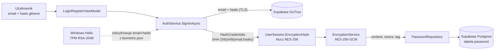
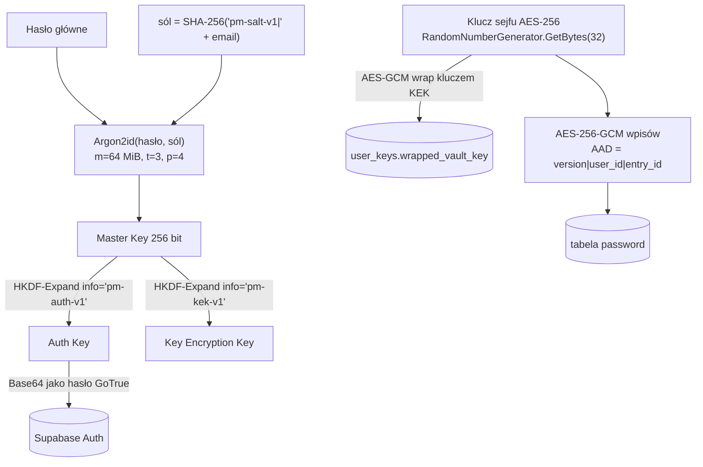

# PasswordManager: analiza bezpieczeństwa i kryptografii

> Stan na: 2026-11-23, gałąź `biometrics`.
> Zakres: stos technologiczny, obecne algorytmy, znalezione problemy oraz propozycja nowego modelu kluczy
> (KDF, losowy klucz sejfu AES-256, zero-knowledge) i zastosowania Diffie-Hellmana (ECDH).

## Spis treści
1. [Stos technologiczny](#1-stos-technologiczny)
2. [Przepływ danych i kluczy (stan obecny)](#2-przepływ-danych-i-kluczy-stan-obecny)
3. [Obecne algorytmy: ocena](#3-obecne-algorytmy-ocena)
4. [Znalezione problemy](#4-znalezione-problemy)
5. [Rekomendowany model kluczy: KDF + klucz sejfu](#5-rekomendowany-model-kluczy-kdf--klucz-sejfu)
6. [Diffie-Hellman (ECDH): gdzie i jak](#6-diffie-hellman-ecdh-gdzie-i-jak)
7. [Kolejność wdrożenia](#7-kolejność-wdrożenia)

---

## 1. Stos technologiczny

| Warstwa | Technologia | Uwagi |
|---|---|---|
| Runtime | .NET 10 (`net10.0`, `net10.0-windows10.0.19041.0`) | Drugi target tylko dla Windows Hello (WinRT) |
| UI | Avalonia 12.1 + Fluent, `MessageBox.Avalonia` | Aplikacja desktopowa, wieloplatformowa |
| MVVM / DI | CommunityToolkit.Mvvm 8.4, Microsoft.Extensions.DependencyInjection/Hosting | Serwisy rejestrowane w `Config/ServiceExtensions.cs` |
| Backend | Supabase 8.3: **GoTrue** (auth), **Postgrest** (tabela `password`), Realtime | Klucz `PublishableKey` w `appsettings.json` (publiczny z założenia) |
| Kryptografia | `System.Security.Cryptography`: `AesGcm`, `SHA256`, `HKDF`, `RandomNumberGenerator` | Brak bibliotek zewnętrznych |
| Biometria | Windows Hello: `KeyCredentialManager` (klucz RSA w TPM) | `Platform/Windows/WindowsHelloAuthenticator.cs` |
| Generator haseł | `PasswordGenerator` 3.0 | Używa `RandomNumberGenerator` (CSPRNG), OK |

---

## 2. Przepływ danych i kluczy (stan obecny)



Najważniejsza obserwacja: **to samo hasło główne** jest używane do logowania w Supabase i do wyliczenia klucza szyfrującego sejf.

---

## 3. Obecne algorytmy: ocena

| Element | Algorytm | Gdzie | Ocena |
|---|---|---|---|
| Klucz sejfu | SHA-256 z „przesuniętych” znaków emaila i hasła (`ShiftChar`) | `Service/AuthService.cs` → `HashCredentials` | ❌ Za słaby: brak KDF, brak kosztu obliczeniowego, kolizje (patrz 4.2) |
| Szyfrowanie wpisów | AES-256-GCM, losowy nonce 96 bit, tag 128 bit | `Service/EncryptionService.cs` | ✅ Poprawny tryb i parametry; ⚠️ brak AAD i wersji formatu |
| Uwierzytelnianie | Supabase GoTrue (email + hasło, serwer trzyma bcrypt) | `AuthService` | ⚠️ Serwer dostaje hasło główne w postaci jawnej (wewnątrz TLS) |
| Izolacja danych użytkowników | RLS w Supabase (do potwierdzenia) | baza | ⚠️ Model nie ma `user_id`; wszystko zależy od polityk RLS |
| Windows Hello | RSA-2048 w TPM → podpis stałego challenge'a → HKDF-SHA256 (losowa sól) → AES-256-GCM z AAD; atestacja TPM; hash emaila z solą | `WindowsHelloAuthenticator.cs`, `BiometricLoginService.cs` | ✅ Dobre; przechowuje hasło główne (świadomy kompromis) |
| Generator haseł | CSPRNG | `AddEditPasswordViewModel.cs` | ✅ |
| Polityka hasła głównego | ≥ 12 znaków + 4 klasy znaków | `LoginRegisterViewModel.cs` | ✅ Rozsądna; można dodać sprawdzanie haseł z wycieków (HIBP, k-anonymity) |

---

## 4. Znalezione problemy

### 4.1 🔴 Krytyczny: brak zero-knowledge
`SignInAsync` wysyła do Supabase `email` i **hasło główne**, a klucz sejfu jest deterministyczną funkcją tych samych danych. Ktoś, kto kontroluje serwer, przechwyci ruch po stronie serwera albo przejmie projekt Supabase:
- widzi hasło przy każdym logowaniu;
- może wyliczyć `HashCredentials(email, hasło)`;
- odszyfrowuje cały sejf.

W menedżerze haseł serwer **nigdy nie powinien widzieć materiału, z którego da się odtworzyć klucz**. Rozwiązanie opisuje sekcja 5.

### 4.2 🔴 Krytyczny: słabe wyprowadzenie klucza AES-256
```csharp
// AuthService.HashCredentials (obecnie)
(char)(33 + (character - 33 + position) % 93)   // ShiftChar
SHA256.HashData(...)                              // jedno przejście
```
- **Brak kosztu obliczeniowego.** Jedno SHA-256 to miliardy prób na sekundę na GPU. Po wycieku bazy hasła da się łamać offline.
- **Brak losowej soli.** Email działa jak sól, ale jest przewidywalny i jawny.
- **`ShiftChar` powoduje kolizje**, czyli różne hasła dają ten sam klucz:
  - `'~'` (126) na pozycji 0 → `(93 % 93) = 0` → `'!'`. Hasła `~abc…` i `!abc…` dają **ten sam klucz**.
  - Znaki spoza ASCII (np. `ą` = 261) są zawijane do zakresu ASCII: `(261 − 33) % 93 = 42` → `'K'`. `ą` i `K` na tej samej pozycji są nierozróżnialne.
  - Znaki < 33 dają ujemne modulo (`' '` → `-1` → znak 32), więc wynik jest nieintuicyjny.
- „Przesuwanie” znaków nie dodaje żadnego bezpieczeństwa (to security through obscurity), za to zmniejsza przestrzeń haseł.

### 4.3 🟠 Wysoki: klucz zależy bezpośrednio od hasła
Brak warstwy „klucza sejfu” ma dwa skutki:
- zmiana hasła głównego (lub emaila!) wymaga pobrania, odszyfrowania i ponownego zaszyfrowania **wszystkich** wpisów;
- przerwanie tej operacji grozi utratą danych.

### 4.4 🟠 Wysoki: AES-GCM bez AAD
`EncryptionService` szyfruje tylko treść. Szyfrogram nie jest powiązany z `id` wiersza ani z użytkownikiem. Ktoś z dostępem do bazy (np. administrator, błąd RLS) może:
- zamieniać szyfrogramy między wierszami;
- przywracać stare wersje wpisów (rollback).

Klient tego nie wykryje.

### 4.5 🟠 Wysoki (do weryfikacji): RLS w Supabase
`EncryptedPassword` nie ma kolumny `user_id`, a `PasswordRepository.ListPasswords()` pobiera *wszystkie* widoczne wiersze. Bez poprawnego RLS użytkownik z publicznym `PublishableKey` i własnym kontem zobaczy szyfrogramy innych. Przy słabym KDF (4.2) da się je łamać offline. Oczekiwana konfiguracja:
```sql
alter table password add column user_id uuid not null default auth.uid()
    references auth.users(id) on delete cascade;
alter table password enable row level security;
create policy "owner only" on password for all
    using (auth.uid() = user_id) with check (auth.uid() = user_id);
```

### 4.6 🟡 Średni
- **Klucze i sekrety w pamięci:**
  - `UserSession.Clear()` ustawia `EncryptionHash = null` bez `CryptographicOperations.ZeroMemory`;
  - odszyfrowane wpisy żyją jako `string`.

  W .NET nie da się tego wyeliminować w 100%, ale klucze (`byte[]`) warto zerować.
- **Schowek:** `CopyPassword` nie czyści schowka. Zalecenie: wyczyścić po ~30 s, jeśli zawartość się nie zmieniła. Na Windows dodatkowo warto wykluczyć hasło z historii schowka i synchronizacji w chmurze (formaty `ExcludeClipboardContentFromMonitorProcessing`, `CanIncludeInClipboardHistory`).
- **Brak automatycznej blokady** po bezczynności lub zablokowaniu ekranu. Wystarczy wyczyścić `UserSession` i wymagać hasła albo Windows Hello.
- **`AutoConnectRealtime = true`** w `ServiceExtensions.ConfigureSupabase`: Realtime nie jest używany, więc to niepotrzebne połączenie i większa powierzchnia ataku.

### 4.7 🟢 Niski
- Brak pola `version` / `alg` w zapisie szyfrogramu utrudni migrację (sekcja 5.6).
- Brak testów jednostkowych kryptografii (round-trip, wykrywanie manipulacji, wektory testowe KDF).
- Opcjonalnie: certificate pinning dla domeny Supabase.

---

## 5. Rekomendowany model kluczy: KDF + klucz sejfu

Model wzorowany na Bitwardenie / 1Password. Cele:
1. serwer nigdy nie widzi hasła ani niczego, z czego da się szybko wyliczyć klucz (zero-knowledge);
2. łamanie hasła offline jest kosztowne (memory-hard KDF);
3. zmiana hasła nie wymaga ponownego szyfrowania wpisów.



### 5.1 KDF: Argon2id (zalecane) lub PBKDF2
**Argon2id** (zwycięzca Password Hashing Competition, zalecany przez OWASP) jest *memory-hard*, więc GPU i ASIC tracą przewagę. .NET nie ma go wbudowanego; można użyć np. `Konscious.Security.Cryptography.Argon2`.

```csharp
using Konscious.Security.Cryptography;

static async Task<byte[]> DeriveMasterKeyAsync(string password, byte[] salt)
{
    using var argon2 = new Argon2id(Encoding.UTF8.GetBytes(password))
    {
        Salt = salt,
        MemorySize = 64 * 1024,   // KiB → 64 MiB
        Iterations = 3,
        DegreeOfParallelism = 4
    };
    return await argon2.GetBytesAsync(32);
}
```

Alternatywa bez zależności, wbudowana: **PBKDF2-HMAC-SHA256** z ≥ 600 000 iteracji (OWASP 2023+).

```csharp
byte[] masterKey = Rfc2898DeriveBytes.Pbkdf2(
    Encoding.UTF8.GetBytes(password), salt, 600_000, HashAlgorithmName.SHA256, 32);
```

**Sól:** musi być znana *przed* zalogowaniem. Dwie opcje:
- **deterministyczna z emaila:** `SHA-256("pm-salt-v1|" + email.Trim().ToLowerInvariant())`. Nie wymaga zapytania przed logowaniem i jest wystarczająco unikalna per użytkownik. Tak robi Bitwarden.
- **losowa, trzymana na serwerze:** pobierana publicznym RPC przed logowaniem. Ujawnia jednak, czy konto istnieje (user enumeration).

Parametry KDF (`alg`, `m`, `t`, `p`) warto zapisać w profilu użytkownika, żeby móc je później podnieść.

> Zmiana emaila zmienia sól, więc przy zmianie emaila trzeba ponownie opakować klucz sejfu. To tania operacja.

### 5.2 Rozdzielenie klucza logowania i klucza szyfrowania (HKDF)
```csharp
byte[] authKey = HKDF.Expand(HashAlgorithmName.SHA256, masterKey, 32, "pm-auth-v1"u8.ToArray());
byte[] kek     = HKDF.Expand(HashAlgorithmName.SHA256, masterKey, 32, "pm-kek-v1"u8.ToArray());

// Do Supabase trafia authKey zamiast hasła:
await supabase.Auth.SignIn(email, Convert.ToBase64String(authKey));
```
- Serwer zna tylko `authKey` (i tak zapisuje go jako bcrypt). Z `authKey` **nie da się** wyliczyć `kek` (HKDF z innym `info`), więc zero-knowledge jest zachowane.
- Atak offline na wyciek bazy nadal wymaga Argon2id dla każdej próby hasła.

### 5.3 Losowy klucz sejfu AES-256 (key wrapping)
Klucz AES nie powinien być wyprowadzany z hasła. Powinien być **losowy**, a z hasła pochodzi tylko klucz, który go „opakowuje”.

```csharp
// Rejestracja
byte[] vaultKey = RandomNumberGenerator.GetBytes(32);          // AES-256
WrappedKey wrapped = AesGcmWrap(kek, vaultKey, aad: $"vault-key-v1|{userId}");
// → zapis do user_keys (wrapped_vault_key, nonce, tag, kdf_params)

// Logowanie
byte[] vaultKey = AesGcmUnwrap(kek, wrapped, aad: $"vault-key-v1|{userId}");
userSession.EncryptionHash = vaultKey;                         // dalej działa EncryptionService
```

Przykładowa tabela:
```sql
create table user_keys (
    user_id            uuid primary key default auth.uid() references auth.users(id) on delete cascade,
    kdf_params         jsonb not null,          -- {"alg":"argon2id","m":65536,"t":3,"p":4}
    wrapped_vault_key  text  not null,          -- base64(nonce|tag|ciphertext)
    public_key         text,                    -- ECDH, sekcja 6
    wrapped_private_key text                    -- ECDH, sekcja 6
);
alter table user_keys enable row level security;
create policy "owner only" on user_keys for all
    using (auth.uid() = user_id) with check (auth.uid() = user_id);
```

Korzyści:
- **zmiana hasła** = nowy `kek` → ponowne opakowanie 32 bajtów, a wpisy zostają bez zmian;
- **reset konta** = utrata `vaultKey` (zgodnie z zero-knowledge; można dodać „kod odzyskiwania”, który osobno opakowuje `vaultKey`);
- klucz ma pełne 256 bitów entropii, niezależnie od jakości hasła.

### 5.4 Szyfrowanie wpisów z AAD
```csharp
byte[] aad = Encoding.UTF8.GetBytes($"pm-entry-v2|{userId}|{entryUuid}");
aes.Encrypt(nonce, plaintext, cipherText, tag, aad);
```
- `entryUuid` generuje klient (`Guid.NewGuid()`) i zapisuje w nowej kolumnie, bo `id` (bigint) powstaje dopiero po `INSERT`.
- Zamiana szyfrogramów między wierszami lub użytkownikami kończy się `AuthenticationTagMismatchException`.
- Nonce 96-bit losowy jest bezpieczny do ~2³² szyfrowań jednym kluczem, z dużym zapasem.

### 5.5 Higiena pamięci
- Zerować `masterKey`, `kek`, `authKey` od razu po użyciu (`CryptographicOperations.ZeroMemory`), a `vaultKey` przy wylogowaniu lub blokadzie.
- `UserSession.Clear()`: zerować tablicę przed ustawieniem `null`.

### 5.6 Migracja istniejących danych
1. Dodać kolumny `version` (domyślnie `1`) i `entry_uuid` do `password` oraz utworzyć tabelę `user_keys`.
2. Przy pierwszym logowaniu po aktualizacji (brak wiersza w `user_keys`):
   1. zalogować się starym sposobem (hasło do GoTrue), wyliczyć stary klucz (`HashCredentials`);
   2. wygenerować `vaultKey`, Argon2id → `authKey` / `kek`, zapisać `user_keys`;
   3. odszyfrować wszystkie wpisy v1 i zaszyfrować je jako v2 (AAD + `vaultKey`);
   4. **na końcu** zmienić hasło GoTrue na `authKey` (`supabase.Auth.Update(new UserAttributes { Password = … })`).
3. Robić to transakcyjnie (najlepiej funkcja RPC w Postgres) albo idempotentnie (wersja per wiersz), żeby przerwanie nie zostawiło sejfu w stanie mieszanym.

### 5.7 Wpływ na Windows Hello
- **Bez zmian:** Hello przechowuje email i hasło, a wyliczanie klucza jest w jednej metodzie `AuthService.DeriveVaultKeyAsync`. Po wdrożeniu KDF logowanie przez Hello przejdzie tę samą ścieżkę.
- **Opcjonalnie:** Hello mogłoby trzymać `vaultKey` + refresh token zamiast hasła (hasło nigdy nie trafia na dysk). Wymaga jednak obsługi rotacji refresh tokenów Supabase. Pole `Version` w `biometric.json` pozwala przeprowadzić taką migrację.

---

## 6. Diffie-Hellman (ECDH): gdzie i jak

**DH nie zastępuje KDF.** KDF zamienia *hasło* na klucz. Diffie-Hellman pozwala **dwóm stronom** uzgodnić wspólny sekret przez niezaufany kanał (tu: przez serwer Supabase) bez przesyłania sekretu. W tym projekcie ma sens w dwóch scenariuszach.

W .NET: `ECDiffieHellman` z krzywą **P-256** (wbudowane, wieloplatformowe). X25519 nie jest wbudowany w .NET; wymagałby zewnętrznej biblioteki (np. NSec/libsodium).

### 6.1 Para kluczy użytkownika
- Przy rejestracji: `ECDiffieHellman.Create(ECCurve.NamedCurves.nistP256)`.
- `public_key` (SubjectPublicKeyInfo, Base64) trafia jawnie do `user_keys`.
- Klucz prywatny (PKCS#8) jest **szyfrowany `vaultKey`** (AES-GCM) i zapisywany jako `wrapped_private_key`.

### 6.2 Udostępnianie wpisu innemu użytkownikowi (styl ECIES)
Każdy udostępniany wpis (lub folder/organizacja) dostaje **własny losowy klucz** `itemKey`. Wpis jest nim zaszyfrowany, a `itemKey` jest „opakowywany” dla każdego odbiorcy:

```csharp
static (byte[] EphemeralPublicKey, byte[] WrappedItemKey) WrapForRecipient(byte[] itemKey, byte[] recipientSpki)
{
    using ECDiffieHellman recipient = ECDiffieHellman.Create();
    recipient.ImportSubjectPublicKeyInfo(recipientSpki, out _);

    using ECDiffieHellman ephemeral = ECDiffieHellman.Create(ECCurve.NamedCurves.nistP256);
    byte[] ephemeralSpki = ephemeral.ExportSubjectPublicKeyInfo();

    byte[] shared = ephemeral.DeriveRawSecretAgreement(recipient.PublicKey);
    byte[] info = [.."pm-share-v1|"u8, ..ephemeralSpki, ..recipientSpki];
    byte[] wrapKey = HKDF.DeriveKey(HashAlgorithmName.SHA256, shared, 32, salt: [], info: info);
    CryptographicOperations.ZeroMemory(shared);

    byte[] wrapped = AesGcmEncrypt(wrapKey, itemKey, aad: info);   // nonce|tag|ciphertext
    CryptographicOperations.ZeroMemory(wrapKey);
    return (ephemeralSpki, wrapped);
}
```
Odbiorca liczy ten sam sekret: `myPrivate.DeriveRawSecretAgreement(ephemeralPublic)` → HKDF → odszyfrowuje `itemKey`. Serwer przechowuje tylko klucze publiczne i opakowane klucze, więc **nie zna treści**.

Efemeryczny klucz nadawcy daje świeży sekret dla każdego udostępnienia. Kompromitacja jednego `wrapKey` nie ujawnia innych.

### 6.3 Parowanie nowego urządzenia / logowanie bez hasła
Nowe urządzenie generuje efemeryczną parę ECDH i pokazuje kod QR z kluczem publicznym (lub wysyła go przez serwer). Zalogowane urządzenie:
1. wykonuje ECDH;
2. wyprowadza klucz przez HKDF;
3. przesyła `vaultKey` zaszyfrowany tym kluczem.

Serwer pośredniczy, ale nie poznaje `vaultKey`.

### 6.4 Pułapki
- **MITM przez serwer:** serwer może podmienić klucz publiczny odbiorcy. Trzeba uwierzytelnić klucz, np. przez **odcisk (fingerprint)** pokazany obu stronom (SHA-256 z SPKI jako słowa lub emoji) albo przez skan QR przy parowaniu.
- Klucz z `DeriveRawSecretAgreement` to surowy punkt krzywej. **Zawsze** przepuszczać go przez HKDF z kontekstem (`info`), nigdy nie używać bezpośrednio jako klucza AES.
- Unieważnienie dostępu (revocation) wymaga rotacji `itemKey` i ponownego zaszyfrowania udostępnionych wpisów.
- **Forward secrecy:** statyczne klucze użytkowników jej nie dają. Efemeryczny klucz nadawcy chroni tylko stronę nadawcy, a dla odbiorcy kompromitacja klucza prywatnego ujawnia wszystkie udostępnienia. Dla menedżera haseł to zwykle akceptowalne.

---

## 7. Kolejność wdrożenia

| # | Zadanie | Problem | Priorytet |
|---|---|---|---|
| 1 | Potwierdzić / dodać RLS + `user_id` w tabeli `password` | 4.5 | 🔴 natychmiast |
| 2 | Argon2id + HKDF (`authKey` / `kek`), `authKey` jako hasło GoTrue | 4.1, 4.2 | 🔴 |
| 3 | Losowy klucz sejfu + `user_keys` + migracja danych v1 → v2 | 4.3, 5.6 | 🔴 |
| 4 | AAD + `version` + `entry_uuid` w `EncryptionService` | 4.4, 4.7 | 🟠 |
| 5 | Zerowanie kluczy, czyszczenie schowka, auto-blokada, wyłączenie Realtime | 4.6 | 🟡 |
| 6 | Testy jednostkowe kryptografii (round-trip, manipulacja, migracja) | 4.7 | 🟡 |
| 7 | ECDH: pary kluczy, udostępnianie, parowanie urządzeń | 6 | 🟢 gdy potrzebne |

Kroki 2–4 najlepiej wdrożyć razem, w jednej migracji formatu (v1 → v2). Każda osobna zmiana schematu kluczy to kolejna migracja wszystkich wpisów.
